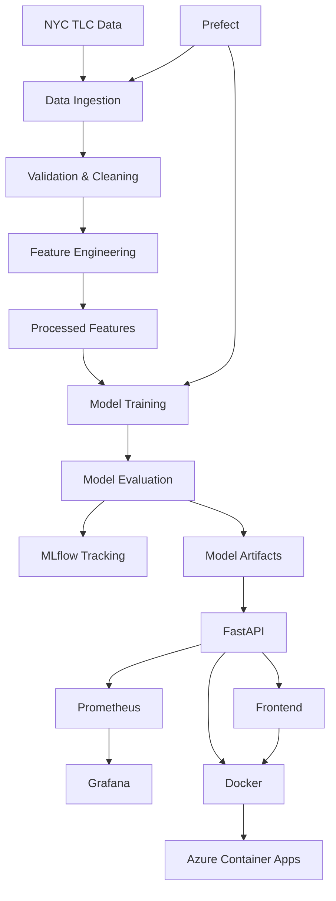

# FleetSense Platform 🚖

An end-to-end MLOps platform for NYC taxi trip-duration prediction, covering automated data ingestion, data processing, model training, experiment tracking, API-based inference, and production monitoring.

## Overview

FleetSense demonstrates the complete machine learning lifecycle, from raw data ingestion to model deployment and monitoring.

**Key Features**
- Automated ingestion of monthly NYC TLC taxi datasets.
- Data validation, cleaning, and feature engineering.
- Configurable ML training with XGBoost, Random Forest, and HistGradientBoosting.
- Model evaluation using MAE, RMSE, and R².
- Experiment tracking with MLflow.
- Workflow orchestration using Prefect.
- FastAPI inference service with single and batch predictions.
- Interactive web frontend.
- Data drift detection using PSI.
- Prometheus metrics and Grafana dashboards.
- Docker-based deployment and Azure infrastructure provisioning.
- Automated testing and CI/CD using GitHub Actions.

## Architecture



## Technology Stack

| Category | Technologies |
|---|---|
| Language | Python |
| Data Processing | Pandas, NumPy, PyArrow |
| Machine Learning | Scikit-learn, XGBoost |
| Experiment Tracking | MLflow |
| Orchestration | Prefect |
| API | FastAPI |
| Frontend | HTML, CSS, JavaScript |
| Storage | Local Filesystem, Azure Blob Storage |
| Monitoring | Prometheus, Grafana |
| Containerization | Docker, Docker Compose |
| Cloud | Microsoft Azure |
| CI/CD | GitHub Actions |
| Testing | Pytest, Ruff |

## Project Structure

```text
FleetSense-Platform/
├── .github/workflows/       # CI/CD pipelines
├── configs/                 # Application and model configs
├── data/                    # Raw, processed and feature data
├── artifacts/               # Model artifacts
├── metadata/                # Pipeline metadata
├── deploy/
│   ├── azure/                # Azure Bicep and deployment scripts
│   └── monitoring/           # Prometheus and Grafana
├── frontend/                # Web application
├── src/fleetsense/
│   ├── api/                  # FastAPI application
│   ├── core/                 # Shared configuration and utilities
│   ├── etl/                  # Data ingestion and validation
│   ├── ml/                   # Training, features and evaluation
│   ├── monitoring/           # Metrics and drift detection
│   ├── storage/              # Storage backends
│   └── workflows/            # Prefect workflows
├── tests/                    # Automated tests
├── Dockerfile
├── Dockerfile.frontend
├── docker-compose.yml
├── Makefile
├── prefect.yaml
├── pyproject.toml
├── requirements.txt
└── README.md
```

## Getting Started

### Prerequisites

- Python 3.11+
- Git
- Docker and Docker Compose

### Installation

```bash
git clone https://github.com/sarayusreeyp/FleetSense-Platform.git
cd FleetSense-Platform

python -m venv .venv
```

Activate the environment:

```bash
# Windows
.venv\Scripts\activate

# Linux/macOS
source .venv/bin/activate
```

Install dependencies:

```bash
pip install -r requirements.txt
pip install -e .
```

Configure environment variables:

```bash
# Windows PowerShell
Copy-Item .env.example .env

# Linux/macOS
cp .env.example .env
```

### Run Workflows

```bash
make run-etl
make run-train
```

### Run API

```bash
make run-api
```

API documentation: http://localhost:8000/docs

### Run with Docker

```bash
docker compose up --build -d
```

| Service | URL |
|---|---|
| Frontend | http://localhost:8080 |
| API | http://localhost:8000 |
| Swagger Docs | http://localhost:8000/docs |
| Prometheus | http://localhost:9090 |
| Grafana | http://localhost:3000 |

### Prefect Orchestration

```bash
prefect server start
```

In another terminal:

```bash
make prefect-setup
make prefect-deploy
make prefect-worker
```

## Azure Deployment

Azure deployment resources and scripts are available under `deploy/azure/`.

```text
deploy/azure/
├── deploy.sh
├── deploy.ps1
├── infra.bicep
└── main.bicep
```

### Azure Deployment

Make sure Azure CLI is installed and you're logged in:

```bash
az login
```

**Windows PowerShell:**
```powershell
.\deploy\azure\deploy.ps1 -ResourceGroup "fleetsense-rg" -Location "centralindia"
```

The scripts use the Bicep templates to provision and deploy the platform on Azure.

## Testing and Code Quality

Run tests:

```bash
python -m pytest -v
```

Run linting:

```bash
ruff check src/ tests/
```

Check formatting:

```bash
ruff format --check src/ tests/
```

## License

This project is licensed under the MIT License. See [LICENSE](LICENSE) for details.
